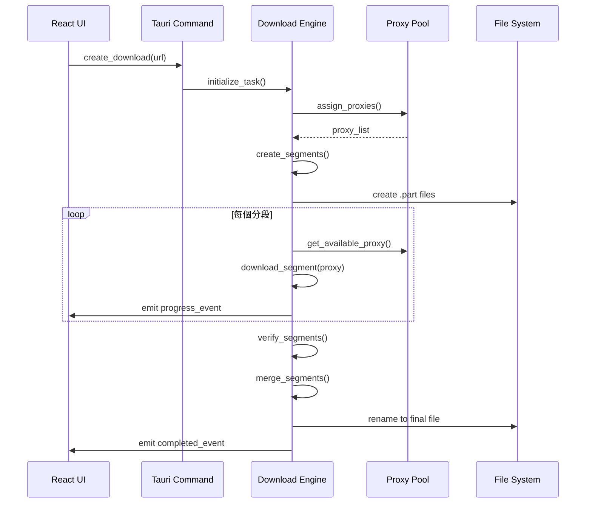
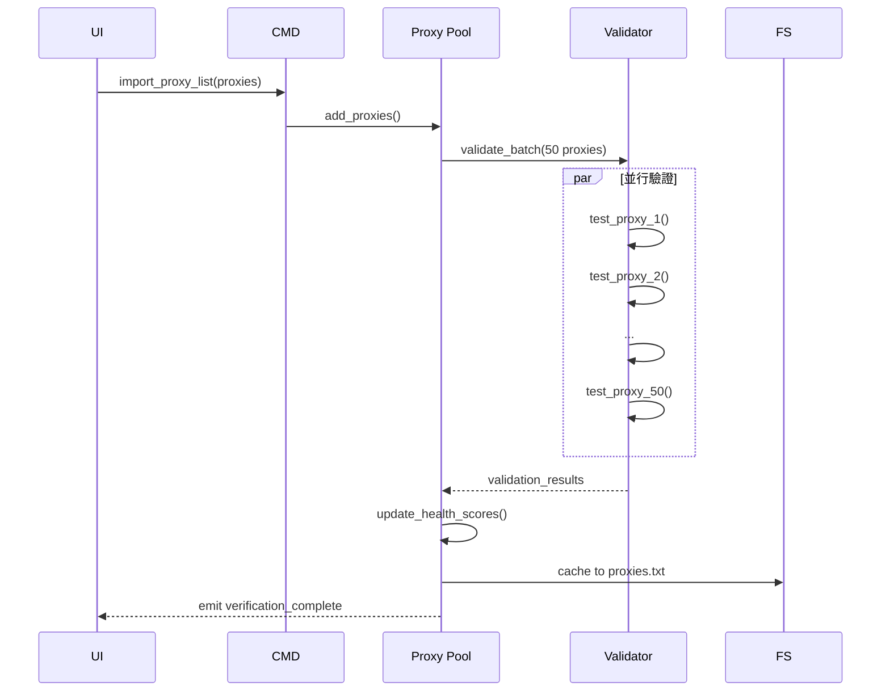

# Zoo Downloader 完整規劃記錄

**建立日期**: 2025-01-27
**功能分支**: `001-core-downloader`
**狀態**: 規劃階段完成

---

## 📋 目錄

1. [規劃概述](#規劃概述)
2. [技術決策摘要](#技術決策摘要)
3. [檔案清單](#檔案清單)
4. [Phase 0: 技術研究](#phase-0-技術研究)
5. [Phase 1: 資料模型](#phase-1-資料模型)
6. [Phase 1: API 合約](#phase-1-api-合約)
7. [開發者快速入門](#開發者快速入門)
8. [下一步行動](#下一步行動)

---

## 規劃概述

### 專案目標
建立一個跨平台（Windows、Linux、macOS）的 HTTP/HTTPS 下載器，支援：
- 多線程分段下載與斷點續傳
- 動態 Proxy 池管理
- 模組化網站支援（執行時動態載入）
- Chrome 瀏覽器整合
- 多語言支援（繁中、英、日）

### 核心架構
- **前端**: React 19 + Material UI 6 + Jotai + react-i18next
- **後端**: Rust + Tauri 2.x + reqwest + tokio
- **模組系統**: libloading + Trait 介面
- **資料儲存**: JSON 檔案（本地、人類可讀）

---

## 技術決策摘要

### 1. Headless Browser 整合
**決策**: 選擇 `headless_chrome`
**理由**:
- 成熟穩定，類 Puppeteer API
- 完整的 Chrome DevTools Protocol 支援
- 活躍維護，社群支援良好
**替代方案**: chromiumoxide（更現代但文檔較少）、fantoccini（需要 Selenium）

### 2. 動態模組載入
**決策**: 選擇 `libloading`
**理由**:
- 執行時動態載入 `.so`/`.dll`/`.dylib`
- 跨平台支援
- 低階控制，native 效能
**替代方案**: abi_stable（ABI 穩定但複雜）、wasm（性能較差）

### 3. 多執行緒下載與 Proxy 管理
**決策**: reqwest + tokio + 自訂健康度評分
**架構**:
```
下載任務
  ├── 分段 1 (10MB) → Proxy A
  ├── 分段 2 (10MB) → Proxy B
  ├── 分段 3 (10MB) → Proxy C
  └── ...
```
**健康度評分**:
- 成功率: 70%
- 平均延遲: 20%
- 最近使用: 10%

### 4. Proxy 驗證策略
**決策**: 主端點 `https://api.myip.com` + 備用端點
**流程**:
1. 批次驗證（每批 50 個，並行）
2. Timeout 5 秒
3. 成功標準：HTTP 200 + 有效 JSON
4. 快取到 `proxies.txt`

### 5. 憑證加密儲存
**決策**: OS Keychain（使用 `keyring` crate）
**對應**:
- Windows: Credential Manager
- macOS: Keychain
- Linux: Secret Service API (libsecret)
**理由**: 最安全，利用 OS 原生加密，無需自行管理金鑰

### 6. 系統托盤整合
**決策**: Tauri 內建 SystemTray API
**功能**:
- 托盤圖示顯示總下載進度
- 右鍵選單（顯示/隱藏、暫停全部、退出）
- 下載完成通知

### 7. 剪貼簿監聽
**決策**: tauri-plugin-clipboard + 200ms 輪詢
**理由**:
- 跨平台支援
- 低資源消耗
- 搭配 URL 正則驗證

### 8. 國際化實作
**決策**: react-i18next + JSON
**結構**:
```
src/locales/
├── zh-TW.json  # 繁體中文（預設）
├── en.json     # 英文
└── ja.json     # 日文
```

---

## 檔案清單

### 已完成（現有）
- ✅ `/nodejs/zoo-downloader/.specify/memory/constitution.md` - 專案憲法
- ✅ `/nodejs/zoo-downloader/specs/001-core-downloader/spec.md` - 功能規格
- ✅ `/nodejs/zoo-downloader/specs/001-core-downloader/checklists/requirements.md` - 品質檢查清單

### 待建立（本次規劃產出）
- 🔲 `/nodejs/zoo-downloader/specs/001-core-downloader/plan.md` - **實施計畫主文件**
- 🔲 `/nodejs/zoo-downloader/specs/001-core-downloader/research.md` - Phase 0 技術研究
- 🔲 `/nodejs/zoo-downloader/specs/001-core-downloader/data-model.md` - Phase 1 資料模型
- 🔲 `/nodejs/zoo-downloader/specs/001-core-downloader/quickstart.md` - 開發者入門
- 🔲 `/nodejs/zoo-downloader/specs/001-core-downloader/contracts/tauri-commands.md` - Tauri API 合約
- 🔲 `/nodejs/zoo-downloader/specs/001-core-downloader/contracts/module-interface.md` - 模組介面規範
- 🔲 `/nodejs/zoo-downloader/specs/001-core-downloader/contracts/storage-schema.md` - JSON 儲存結構

---

## Phase 0: 技術研究

### research.md 內容大綱

#### 1. Headless Browser 整合
**問題**: 如何在 Rust 中執行 JavaScript 來處理動態生成的下載連結？
**研究結果**: 使用 `headless_chrome` crate
**實作要點**:
```rust
use headless_chrome::{Browser, LaunchOptionsBuilder};

let browser = Browser::new(LaunchOptionsBuilder::default().build()?)?;
let tab = browser.new_tab()?;
tab.navigate_to("https://example.com")?;
let download_link = tab.evaluate("document.querySelector('a.download').href", false)?;
```

#### 2. 動態模組載入
**問題**: 如何實現執行時動態載入網站支援模組？
**研究結果**: 使用 `libloading` + Trait 介面
**架構**:
```rust
pub trait WebsiteModule {
    fn name(&self) -> &str;
    fn supported_domains(&self) -> Vec<String>;
    fn extract_download_url(&self, page_url: &str) -> Result<String>;
}

// 模組載入器
let lib = unsafe { libloading::Library::new("modules/mediafire.so")? };
let module: Symbol<fn() -> Box<dyn WebsiteModule>> = unsafe { lib.get(b"create_module")? };
```

#### 3. 多執行緒下載策略
**問題**: 如何高效實現多線程分段下載？
**研究結果**: reqwest + tokio + Arc<Mutex<DownloadState>>
**關鍵設計**:
- 預設 8 個並發下載執行緒
- 每個分段 10MB（可配置，最小 5MB）
- 使用 tokio::spawn 並行下載各分段
- Arc<Mutex<>> 共享進度狀態

#### 4. Proxy 健康度評分算法
**公式**:
```
健康度 = (成功率 × 0.7) + ((1 - 標準化延遲) × 0.2) + (最近使用加成 × 0.1)
```
**實作**:
```rust
fn calculate_health_score(proxy: &ProxyInfo) -> f64 {
    let success_rate = proxy.successful_requests as f64 / proxy.total_requests as f64;
    let latency_score = 1.0 - (proxy.avg_latency_ms / 5000.0).min(1.0);
    let recency_score = if proxy.last_used.elapsed().as_secs() < 3600 { 1.0 } else { 0.0 };

    success_rate * 0.7 + latency_score * 0.2 + recency_score * 0.1
}
```

#### 5. Proxy 驗證最佳實踐
**驗證流程**:
1. 批次分組（每批 50 個）
2. 並行驗證（tokio::spawn_blocking）
3. 主端點：`https://api.myip.com`
4. 備用端點：`https://httpbin.org/ip`、`https://ifconfig.me/ip`
5. Timeout: 5 秒
6. 重試: 1 次

#### 6. 憑證加密策略
**選擇**: OS Keychain（`keyring` crate）
**實作**:
```rust
use keyring::Entry;

// 儲存憑證
let entry = Entry::new("zoo-downloader", "mediafire-username")?;
entry.set_password("user_password")?;

// 讀取憑證
let password = entry.get_password()?;
```

#### 7. 剪貼簿監聽實作
**策略**: 輪詢 + 正則驗證
**實作**:
```rust
use tauri_plugin_clipboard::Clipboard;

let mut last_content = String::new();
loop {
    tokio::time::sleep(Duration::from_millis(200)).await;
    let current = clipboard.read_text()?;
    if current != last_content && is_valid_url(&current) {
        emit_clipboard_detected_event(current);
        last_content = current;
    }
}
```

#### 8. 國際化最佳實踐
**選擇**: react-i18next + JSON
**初始化**:
```typescript
import i18n from 'i18next';
import { initReactI18next } from 'react-i18next';

i18n.use(initReactI18next).init({
  resources: {
    'zh-TW': { translation: require('./locales/zh-TW.json') },
    'en': { translation: require('./locales/en.json') },
    'ja': { translation: require('./locales/ja.json') }
  },
  lng: navigator.language || 'zh-TW',
  fallbackLng: 'en'
});
```

---

## Phase 1: 資料模型

### data-model.md 內容大綱

#### 實體 1: DownloadTask（下載任務）
**屬性**:
```rust
struct DownloadTask {
    id: Uuid,
    url: String,
    filename: String,
    filepath: PathBuf,
    filesize: u64,
    status: DownloadStatus,
    progress: f64,  // 0.0 - 100.0
    current_speed: u64,  // bytes/sec
    segments: Vec<DownloadSegment>,
    proxy_id: Option<Uuid>,
    category: Option<String>,
    created_at: DateTime<Utc>,
    completed_at: Option<DateTime<Utc>>,
}

enum DownloadStatus {
    Pending,
    Initializing,
    Downloading,
    Paused,
    Cancelling,
    Cancelled,
    Completed,
    Failed,
    VerifyingIntegrity,
    MergingSegments,
}
```

**狀態轉換規則**:
```
Pending → Initializing → Downloading ⇄ Paused
                          ↓
                       Cancelling → Cancelled
                          ↓
                    VerifyingIntegrity → MergingSegments → Completed
                          ↓
                       Failed
```

**驗證規則**:
- URL 必須是有效的 HTTP/HTTPS
- filename 不得包含作業系統禁用字元 (`<>:"/\|?*`)
- filesize > 0
- progress 範圍 0.0 - 100.0

#### 實體 2: DownloadSegment（下載分段）
**屬性**:
```rust
struct DownloadSegment {
    id: Uuid,
    task_id: Uuid,
    start_byte: u64,
    end_byte: u64,
    downloaded_bytes: u64,
    status: SegmentStatus,
    thread_id: Option<usize>,
    proxy_id: Option<Uuid>,
    retry_count: u32,
}

enum SegmentStatus {
    Pending,
    Downloading,
    Completed,
    Failed,
}
```

**完整性驗證**:
```rust
fn verify_segment_integrity(segment: &DownloadSegment, file_path: &Path) -> Result<bool> {
    let expected_size = segment.end_byte - segment.start_byte + 1;
    let actual_size = fs::metadata(file_path)?.len();

    // 容差 ±1 byte
    Ok((actual_size as i64 - expected_size as i64).abs() <= 1)
}
```

#### 實體 3: ProxyInfo（Proxy 資訊）
**屬性**:
```rust
struct ProxyInfo {
    id: Uuid,
    host: String,
    port: u16,
    proxy_type: ProxyType,  // HTTP only for now
    status: ProxyStatus,
    avg_latency_ms: f64,
    successful_requests: u64,
    failed_requests: u64,
    last_verified: DateTime<Utc>,
    last_used: DateTime<Utc>,
    health_score: f64,  // 0.0 - 1.0
}

enum ProxyStatus {
    Unknown,
    Verifying,
    Active,
    Failed,
    Blacklisted,
}
```

**健康度評分算法**:
```rust
impl ProxyInfo {
    fn calculate_health_score(&self) -> f64 {
        let total_requests = self.successful_requests + self.failed_requests;
        if total_requests == 0 { return 0.0; }

        let success_rate = self.successful_requests as f64 / total_requests as f64;
        let latency_score = 1.0 - (self.avg_latency_ms / 5000.0).min(1.0);
        let recency_bonus = if self.last_used.elapsed().unwrap().as_secs() < 3600 { 1.0 } else { 0.0 };

        success_rate * 0.7 + latency_score * 0.2 + recency_bonus * 0.1
    }
}
```

#### 實體 4: WebsiteModule（網站模組）
**Trait 定義**:
```rust
pub trait WebsiteModule: Send + Sync {
    fn metadata(&self) -> ModuleMetadata;
    fn can_handle(&self, url: &str) -> bool;
    fn extract_download_info(&self, url: &str, options: ExtractOptions) -> Result<DownloadInfo>;
    fn handle_captcha(&self, captcha_url: &str) -> Result<String>;
}

pub struct ModuleMetadata {
    pub id: String,
    pub name: String,
    pub version: String,
    pub supported_domains: Vec<String>,
    pub requires_auth: bool,
}

pub struct ExtractOptions {
    pub credentials: Option<Credentials>,
    pub cookies: Option<Vec<Cookie>>,
    pub use_headless_browser: bool,
}
```

#### 實體 5: AppSettings（應用程式設定）
**結構**:
```rust
struct AppSettings {
    // 一般設定
    pub language: String,  // "zh-TW" | "en" | "ja"
    pub theme: Theme,      // Light | Dark
    pub auto_start: bool,

    // 下載設定
    pub default_download_dir: PathBuf,
    pub max_concurrent_downloads: Option<usize>,  // None = 無限制
    pub segment_size_mb: u64,  // 預設 10MB
    pub thread_count: usize,   // 預設 8
    pub speed_limit_mode: SpeedLimitMode,
    pub speed_limit_kbps: Option<u64>,

    // Proxy 設定
    pub enable_proxy: bool,
    pub proxy_verification_interval_hours: u64,  // 預設 24

    // UI 設定
    pub enable_clipboard_monitoring: bool,
    pub enable_notifications: bool,
    pub enable_system_tray: bool,

    // 進階設定
    pub auto_retry_enabled: bool,
    pub max_retry_count: u32,
    pub retry_interval_secs: u64,
}

enum SpeedLimitMode {
    Unlimited,
    Fixed,  // 使用 speed_limit_kbps
}
```

#### 實體 6: DownloadHistory（下載歷史）
**屬性**:
```rust
struct DownloadHistory {
    pub entries: Vec<HistoryEntry>,
}

struct HistoryEntry {
    pub id: Uuid,
    pub url: String,
    pub filename: String,
    pub filesize: u64,
    pub status: DownloadStatus,
    pub started_at: DateTime<Utc>,
    pub completed_at: Option<DateTime<Utc>>,
    pub error_message: Option<String>,
}
```

**查詢方法**:
```rust
impl DownloadHistory {
    pub fn filter_by_status(&self, status: DownloadStatus) -> Vec<&HistoryEntry>;
    pub fn filter_by_date_range(&self, start: DateTime<Utc>, end: DateTime<Utc>) -> Vec<&HistoryEntry>;
    pub fn search_by_filename(&self, keyword: &str) -> Vec<&HistoryEntry>;
}
```

#### 關鍵時序圖

**下載生命週期**:


**Proxy 池管理流程**:


---

## Phase 1: API 合約

### contracts/tauri-commands.md 內容大綱

#### 下載管理命令

##### 1. create_download
```rust
#[tauri::command]
async fn create_download(
    url: String,
    filename: Option<String>,
    download_dir: Option<PathBuf>,
) -> Result<Uuid, String>
```
**說明**: 建立新的下載任務
**回傳**: 任務 ID
**錯誤**: 無效 URL、磁碟空間不足

##### 2. start_download
```rust
#[tauri::command]
async fn start_download(task_id: Uuid) -> Result<(), String>
```
**說明**: 開始或恢復下載
**錯誤**: 任務不存在、已在下載中

##### 3. pause_download
```rust
#[tauri::command]
async fn pause_download(task_id: Uuid) -> Result<(), String>
```

##### 4. cancel_download
```rust
#[tauri::command]
async fn cancel_download(task_id: Uuid) -> Result<(), String>
```

##### 5. get_download_list
```rust
#[tauri::command]
async fn get_download_list(filter: Option<DownloadFilter>) -> Result<Vec<DownloadTask>, String>

struct DownloadFilter {
    status: Option<DownloadStatus>,
    category: Option<String>,
}
```

##### 6. get_download_progress
```rust
#[tauri::command]
async fn get_download_progress(task_id: Uuid) -> Result<DownloadProgress, String>

struct DownloadProgress {
    progress: f64,
    speed: u64,
    eta_seconds: u64,
    downloaded_bytes: u64,
    total_bytes: u64,
}
```

##### 7. import_batch_downloads
```rust
#[tauri::command]
async fn import_batch_downloads(file_path: PathBuf) -> Result<Vec<Uuid>, String>
```
**說明**: 從文字檔匯入批次 URL（換行分隔）

#### Proxy 管理命令

##### 8. import_proxy_list
```rust
#[tauri::command]
async fn import_proxy_list(proxies: Vec<String>) -> Result<(), String>
```
**格式**: `["127.0.0.1:8080", "192.168.1.1:3128"]`

##### 9. get_proxy_list
```rust
#[tauri::command]
async fn get_proxy_list() -> Result<Vec<ProxyInfo>, String>
```

##### 10. remove_proxy
```rust
#[tauri::command]
async fn remove_proxy(proxy_id: Uuid) -> Result<(), String>
```

#### 設定管理命令

##### 11. get_settings
```rust
#[tauri::command]
async fn get_settings() -> Result<AppSettings, String>
```

##### 12. update_settings
```rust
#[tauri::command]
async fn update_settings(settings: AppSettings) -> Result<(), String>
```

##### 13. export_settings
```rust
#[tauri::command]
async fn export_settings(file_path: PathBuf) -> Result<(), String>
```

##### 14. import_settings
```rust
#[tauri::command]
async fn import_settings(file_path: PathBuf) -> Result<(), String>
```

#### 前端事件

##### 1. progress-updated
```typescript
interface ProgressUpdateEvent {
  taskId: string;
  progress: number;
  speed: number;
  etaSeconds: number;
}

listen<ProgressUpdateEvent>('progress-updated', (event) => {
  updateDownloadProgress(event.payload);
});
```

##### 2. status-changed
```typescript
interface StatusChangeEvent {
  taskId: string;
  oldStatus: DownloadStatus;
  newStatus: DownloadStatus;
}
```

##### 3. clipboard-detected
```typescript
interface ClipboardDetectedEvent {
  url: string;
  timestamp: number;
}
```

##### 4. captcha-required
```typescript
interface CaptchaRequiredEvent {
  taskId: string;
  captchaImageUrl: string;
  moduleId: string;
}
```

### contracts/module-interface.md 內容大綱

#### 模組描述檔（module.json）
```json
{
  "id": "mediafire-downloader",
  "name": "MediaFire Downloader",
  "version": "1.0.0",
  "author": "Zoo Downloader Team",
  "supported_domains": ["mediafire.com", "www.mediafire.com"],
  "requires_auth": false,
  "requires_headless_browser": true
}
```

#### Rust Trait 介面
```rust
// 模組必須實作此 Trait
pub trait WebsiteModule: Send + Sync {
    fn metadata(&self) -> ModuleMetadata;
    fn can_handle(&self, url: &str) -> bool;
    fn extract_download_info(&self, url: &str, options: ExtractOptions) -> Result<DownloadInfo>;
    fn handle_captcha(&self, captcha_url: &str) -> Result<String>;
}

// 模組入口函數（必須導出）
#[no_mangle]
pub extern "C" fn create_module() -> *mut dyn WebsiteModule {
    Box::into_raw(Box::new(MediaFireModule::new()))
}
```

#### CAPTCHA 處理範例
```rust
impl WebsiteModule for MediaFireModule {
    fn handle_captcha(&self, captcha_url: &str) -> Result<String> {
        // 發送事件到前端顯示 CAPTCHA UI
        emit_captcha_required_event(self.metadata().id, captcha_url);

        // 等待使用者輸入（透過 channel）
        let captcha_answer = self.captcha_receiver.recv()?;

        Ok(captcha_answer)
    }
}
```

### contracts/storage-schema.md 內容大綱

#### 檔案位置

**跨平台路徑**:
- **Windows**: `%APPDATA%\zoo-downloader\`
- **macOS**: `~/Library/Application Support/zoo-downloader/`
- **Linux**: `~/.config/zoo-downloader/`

#### config.json（AppSettings）
```json
{
  "language": "zh-TW",
  "theme": "Dark",
  "auto_start": false,
  "default_download_dir": "/Users/user/Downloads",
  "max_concurrent_downloads": null,
  "segment_size_mb": 10,
  "thread_count": 8,
  "speed_limit_mode": "Unlimited",
  "speed_limit_kbps": null,
  "enable_proxy": false,
  "proxy_verification_interval_hours": 24,
  "enable_clipboard_monitoring": true,
  "enable_notifications": true,
  "enable_system_tray": true,
  "auto_retry_enabled": true,
  "max_retry_count": 3,
  "retry_interval_secs": 5
}
```

#### downloads/{task_id}.json（DownloadTask）
```json
{
  "id": "550e8400-e29b-41d4-a716-446655440000",
  "url": "https://example.com/file.zip",
  "filename": "file.zip",
  "filepath": "/Users/user/Downloads/file.zip",
  "filesize": 104857600,
  "status": "Downloading",
  "progress": 45.5,
  "current_speed": 5242880,
  "segments": [
    {
      "id": "...",
      "start_byte": 0,
      "end_byte": 10485759,
      "downloaded_bytes": 10485760,
      "status": "Completed"
    }
  ],
  "proxy_id": null,
  "category": "Archive",
  "created_at": "2025-01-27T10:00:00Z",
  "completed_at": null
}
```

#### proxies.txt（Proxy 快取）
```
# Zoo Downloader Proxy Cache
# Last updated: 2025-01-27T10:00:00Z
127.0.0.1:8080
192.168.1.1:3128
proxy.example.com:3128
```

#### history.json（DownloadHistory）
```json
{
  "entries": [
    {
      "id": "...",
      "url": "https://example.com/file.zip",
      "filename": "file.zip",
      "filesize": 104857600,
      "status": "Completed",
      "started_at": "2025-01-27T10:00:00Z",
      "completed_at": "2025-01-27T10:15:30Z",
      "error_message": null
    }
  ]
}
```

---

## 開發者快速入門

### quickstart.md 內容大綱

#### 1. 環境設定

**必要工具**:
- Rust 1.75+
- Node.js 18+
- Tauri CLI: `cargo install tauri-cli`

**安裝依賴**:
```bash
# 後端依賴
cd src-tauri
cargo build

# 前端依賴
npm install
```

#### 2. 專案結構導覽

```
zoo-downloader/
├── src-tauri/              # Rust 後端
│   ├── src/
│   │   ├── main.rs         # 應用程式進入點
│   │   ├── commands/       # Tauri 命令處理器
│   │   ├── download/       # 下載引擎
│   │   ├── proxy/          # Proxy 池管理
│   │   ├── modules/        # 模組載入器
│   │   └── storage/        # JSON 儲存
│   └── Cargo.toml
├── src/                    # React 前端
│   ├── components/         # UI 元件
│   ├── pages/              # 頁面
│   ├── stores/             # Jotai 狀態管理
│   ├── locales/            # i18n JSON
│   └── App.tsx
└── specs/                  # 規格文件
```

#### 3. 開發工作流程

**啟動開發伺服器**:
```bash
npm run tauri dev
```

**建構生產版本**:
```bash
npm run tauri build
```

**執行測試**:
```bash
# Rust 測試
cargo test

# React 測試
npm test
```

#### 4. 建立網站支援模組

**步驟 1**: 建立模組專案
```bash
cargo new --lib modules/example-downloader
```

**步驟 2**: 實作 WebsiteModule Trait
```rust
use zoo_downloader_sdk::WebsiteModule;

pub struct ExampleModule;

impl WebsiteModule for ExampleModule {
    fn metadata(&self) -> ModuleMetadata {
        ModuleMetadata {
            id: "example-downloader".to_string(),
            name: "Example Downloader".to_string(),
            version: "1.0.0".to_string(),
            supported_domains: vec!["example.com".to_string()],
            requires_auth: false,
        }
    }

    fn can_handle(&self, url: &str) -> bool {
        url.contains("example.com")
    }

    fn extract_download_info(&self, url: &str, options: ExtractOptions) -> Result<DownloadInfo> {
        // 實作下載連結解析邏輯
        Ok(DownloadInfo {
            direct_url: "https://example.com/download/file.zip".to_string(),
            filename: "file.zip".to_string(),
            filesize: Some(104857600),
        })
    }

    fn handle_captcha(&self, captcha_url: &str) -> Result<String> {
        // 發送 CAPTCHA 到前端 UI
        unimplemented!()
    }
}

#[no_mangle]
pub extern "C" fn create_module() -> *mut dyn WebsiteModule {
    Box::into_raw(Box::new(ExampleModule))
}
```

**步驟 3**: 編譯為動態庫
```toml
[lib]
crate-type = ["cdylib"]
```

**步驟 4**: 放置模組
```bash
cp target/release/libexample_downloader.so ~/.zoo-downloader/modules/
```

#### 5. 常見開發任務

**新增 Tauri 命令**:
1. 在 `src-tauri/src/commands/` 建立新檔案
2. 定義命令函數（加上 `#[tauri::command]`）
3. 在 `main.rs` 中註冊命令

**修改 UI**:
1. 編輯 `src/components/` 中的 React 元件
2. 使用 Material UI 元件庫
3. 透過 Jotai 存取全域狀態

**新增翻譯**:
1. 編輯 `src/locales/{zh-TW|en|ja}.json`
2. 使用 `useTranslation()` hook 在元件中使用

---

## 下一步行動

### 立即行動（本次會議後）
1. ✅ 建立 `PLANNING_RECORD.md`（本文件）
2. 🔲 建立核心 `plan.md`（簡化版，標記關鍵內容）
3. 🔲 決定是否建立所有詳細文件（research.md, data-model.md, contracts/, quickstart.md）

### Phase 2: 實作任務生成
執行 `/speckit.tasks` 命令生成 `tasks.md`，包含：
- 依賴排序的任務清單
- 每個任務的預估複雜度
- 實作順序建議

### Phase 3: 開始實作
根據 tasks.md 的順序開始實作，優先順序：
1. **基礎架構**：Tauri 專案初始化、目錄結構
2. **核心下載引擎**：多線程分段下載、斷點續傳
3. **Proxy 池管理**：驗證、健康度評分、動態分配
4. **模組載入器**：libloading 整合、Trait 介面
5. **React UI**：Material UI 元件、Jotai 狀態管理
6. **系統整合**：托盤、剪貼簿、通知、i18n

---

## 附錄

### 關鍵效能指標（來自 Success Criteria）

| 指標 | 目標值 | 測試方法 |
|------|--------|----------|
| UI 響應時間 | < 100ms | 點擊按鈕到 UI 更新的延遲 |
| 啟動時間 | < 3 秒 | 冷啟動到主視窗顯示 |
| 下載速度提升 | +50% | 多線程 vs 單線程對比測試 |
| 並發下載數 | 100 個 | 效能測試不降級 |
| 記憶體使用 | < 2GB | 長時間執行監控 |
| CPU 使用率 | < 80% | 滿載下載時監控 |
| 斷點續傳成功率 | > 95% | 網路中斷恢復測試 |
| Proxy 驗證準確率 | > 90% | 驗證結果與實際下載成功率對比 |

### 依賴清單

**Rust 後端**:
```toml
[dependencies]
tauri = "2.0"
tokio = { version = "1", features = ["full"] }
reqwest = { version = "0.11", features = ["json", "stream"] }
serde = { version = "1", features = ["derive"] }
serde_json = "1"
uuid = { version = "1", features = ["v4"] }
chrono = { version = "0.4", features = ["serde"] }
libloading = "0.8"
headless_chrome = "1.0"
keyring = "2.0"
```

**React 前端**:
```json
{
  "dependencies": {
    "react": "^19.0.0",
    "@mui/material": "^6.0.0",
    "@emotion/react": "^11.0.0",
    "@emotion/styled": "^11.0.0",
    "jotai": "^2.0.0",
    "react-i18next": "^14.0.0",
    "i18next": "^23.0.0",
    "@tauri-apps/api": "^2.0.0"
  }
}
```

---

**文件版本**: 1.0.0
**最後更新**: 2025-01-27
**維護者**: Zoo Downloader Team
